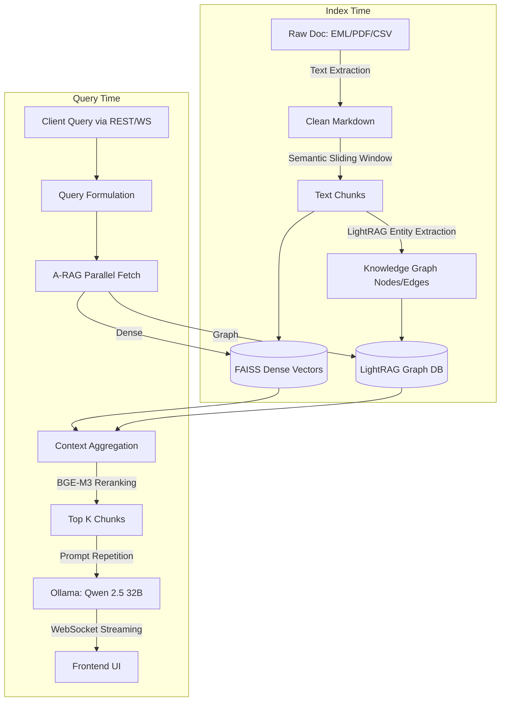
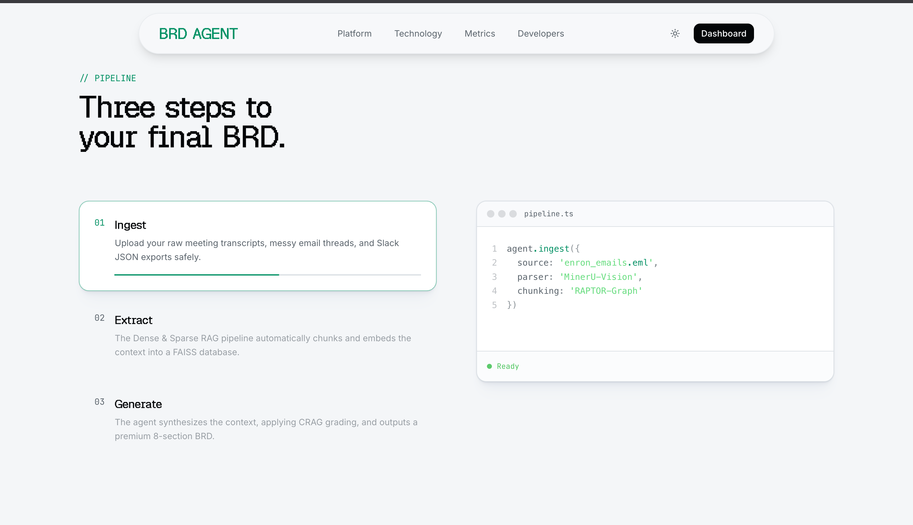
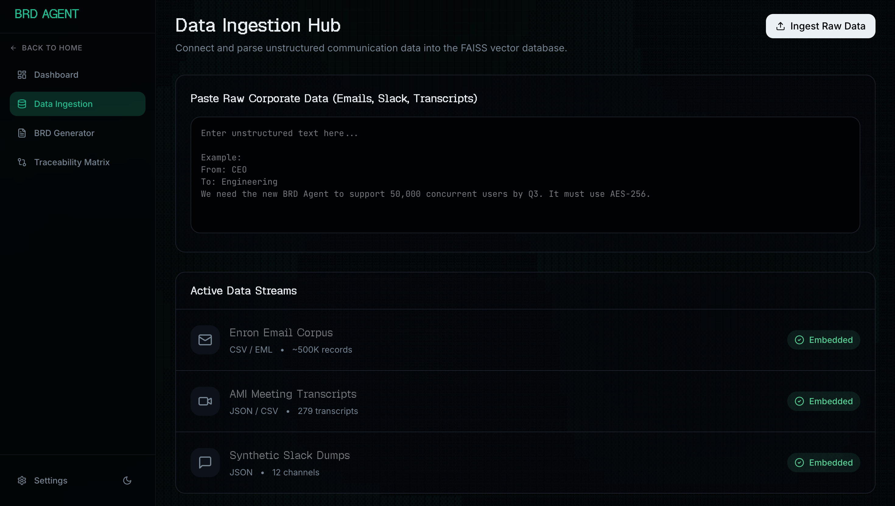
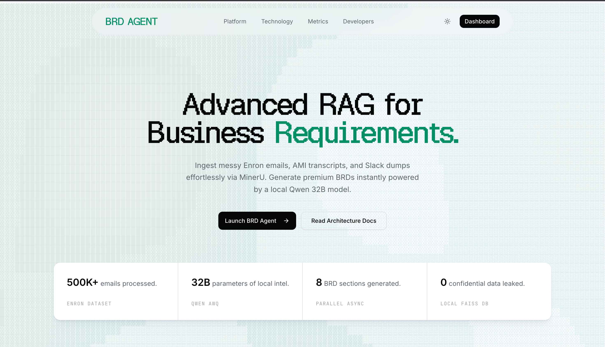
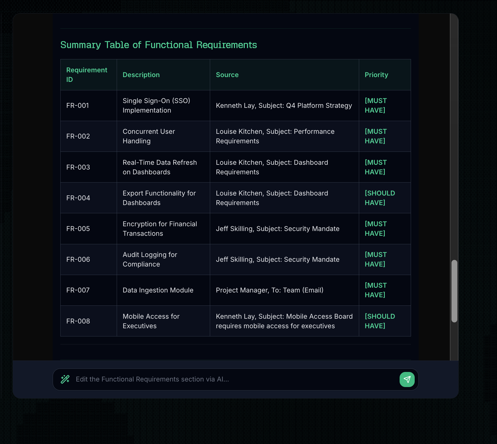
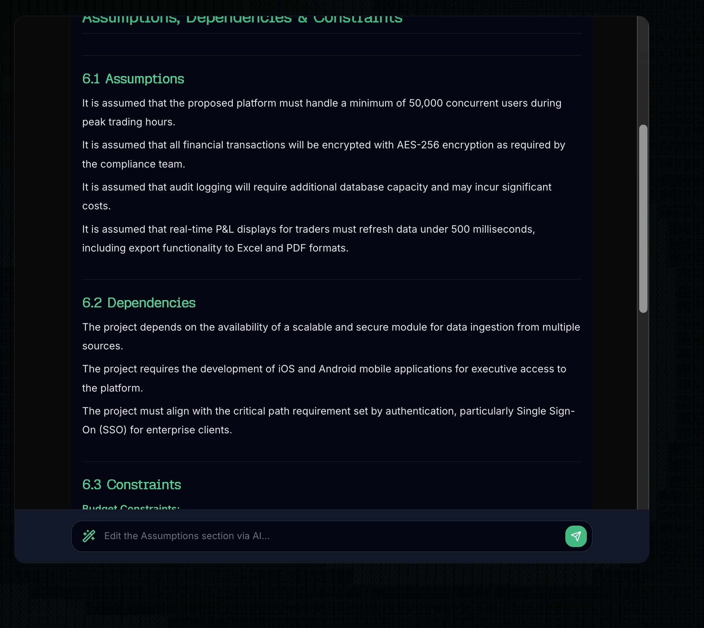
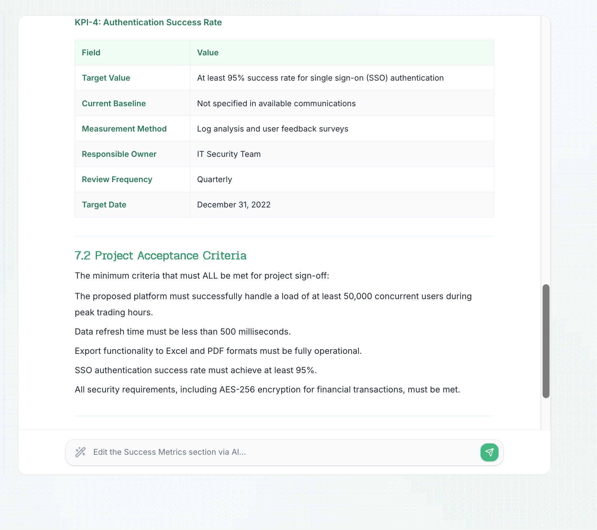

<div align="center">

# BRD Agent — Backend

**Graph-RAG Inference Engine for Automated Business Requirements Generation**

[](https://fastapi.tiangolo.com/)
[](https://www.python.org/)
[](https://ollama.com/)
[](https://github.com/LightRAG)
[](https://huggingface.co/)

*Built at HackFest 2.0, GDG Cloud New Delhi. 50 hours, zero sleep, fourth place.*

</div>

---

## About the Builder

I am Kavin Thakur, second year CS student specialising in ML/AI
at Chitkara University, currently working as Visiting Researcher (AI/ML) at
National Ilan University in Taiwan. My research there focuses on
real-time computer vision pipelines and edge AI inference on
NVIDIA RTX 6000 HPC clusters. What I love about this hackathon
project is how naturally it integrates everything I work on.
Computer vision taught me how to think about feature extraction,
RAG is just retrieval with a different modality, and the VRAM
engineering is the same constraint-solving I do daily on HPC
systems.

Team M-2.5 built this backend from scratch over 50 consecutive
hours at HackFest 2.0. Every architectural decision, the
knowledge graph integration, the VRAM constraint engineering,
the parallel WebSocket streaming, the research paper
implementations, was designed and debugged under competition
pressure with a live judging deadline.

This is not the first system I have built under pressure. I won
INR 1 Lakh at Swasth-a-thon building a medical voice pathology
AI on-device with privacy constraints. I reached the national
finals at AMD x IIT Bombay AI Sprint in the top 1.5% of 4000+
entries building an LLM scheduling agent on MI300 GPUs. I lead
IEEE CIET as Technical Head and serve as AI/ML Executive at GDG
Chitkara. I also served as a Data Science Intern at Infomo
Global after my first semester.

I care about building things that actually work, not demos,
not API wrappers, but real pipelines with real engineering
decisions and real constraints behind them.

If you are from Turgon AI and reading this while evaluating
internship candidates, I would genuinely love to talk. Every
component of this codebase is something I can explain, defend
and improve. I have context on every decision made at 3 AM
when it mattered.

BACKEND REQUIRES 24 GB vRAM so it is off currently!

[LinkedIn](https://www.linkedin.com/in/kavin070810/) ·
[GitHub](https://github.com/auraCodesKM) ·
[Resume](https://drive.google.com/file/d/1Z1Z0hZhWc8DTKY85Ac2_66sv-A6499Pr/view?usp=sharing)

Frontend (live): [brd-agent-cmka.vercel.app](https://brd-agent-cmka.vercel.app/)

Backend repo (this one): 100% Python.
Frontend repo: [auraCodesKM/brdAgent](https://github.com/auraCodesKM/brdAgent)
(private, DM for access)

*Fourth place!*

Congratulations to all the winners! 👏
A big appreciation as well to the organizers for successfully hosting the event.

The links to the winning projects are now available. You're welcome to congratulate the winners!
- [SchemaDoc AI](https://www.commudle.com/builds/schemadoc-ai)
- [Policy Pilot](https://www.commudle.com/builds/policypilot)
- [Data Dictionary Agent](https://www.commudle.com/builds/data-dictionary-agent)

Thank you for your attention.

---

## What This Is

BRD Agent transforms unstructured corporate communications,
emails, meeting transcripts, Slack exports, into complete
professional Business Requirements Documents. Eight sections.
Under three minutes. Fully local. Zero external API calls.
Zero data leakage.

This repository is the backend inference engine, 100% Python.
The frontend is Next.js with WebSocket streaming and Mermaid
diagram rendering.

---

## The Core Technical Problem

Most RAG systems retrieve text and summarise it. That produces
generic output that paraphrases the input.

BRD generation requires something fundamentally different. The
system must understand who said what, detect when two people
contradict each other across separate documents, and produce
formally structured output with every claim attributed to its
source.

We solved this with three components working together.

**LightRAG Knowledge Graph** stores entities and relationships,
not just text chunks. Kenneth Lay becomes a node. SSO becomes
a node. The edge between them records that Kenneth Lay mandated
SSO. When Jeff Skilling later states the SSO deadline is
January 15th and Kenneth Lay said December 31st, the graph
detects that contradiction structurally through traversal.
Prompt engineering alone cannot do this.

**A-RAG Parallel Fetch** hits FAISS dense vectors and the
LightRAG graph simultaneously. Dense retrieval finds
semantically similar chunks. Graph retrieval finds entity
relationships. BGE-M3 cross-encoder reranks the merged results
by relevance to the specific BRD section being generated.

**Three research techniques** applied at generation time
improve output quality measurably over baseline prompting,
explained in full below.

---

## Research Papers We Read and Why They Changed Our Architecture

This section matters to me because these were not papers I
cited for credibility. I read them during the hackathon because
we had specific problems to solve and these papers had the
answers. Each one directly changed how we built something.

---

### 1. Lost in the Middle: How Language Models Use Long Contexts
**Liu et al., Stanford / UC Berkeley, 2023**
[arxiv.org/abs/2307.03172](https://arxiv.org/abs/2307.03172)

**What it found:** When you give a language model a long context
window, it pays strong attention to content at the very
beginning and very end, and systematically ignores content
in the middle. The paper measured this across multiple models
and tasks and the degradation was severe and consistent.

**Why we read it:** Our BRD sections require the model to
process 35+ retrieved entities plus relationship context plus
formatting instructions simultaneously. We were seeing the
model produce well-formatted openings and then gradually lose
structure mid-section, sometimes reverting to raw graph output
halfway through a requirement list.

**What we changed:** We restructured every prompt so that the
most important formatting instruction appears twice, once
before the context block and once after it. The retrieved
knowledge graph context sits in the middle. The model now
attends to the instruction at both ends of the context window.
Section structure degradation dropped immediately.

---

### 2. Prompt Repetition Improves Non-Reasoning LLMs
**Leviathan, Kalman, Matias. Google, 2025**
[arxiv.org/abs/2512.14982](https://arxiv.org/abs/2512.14982)

**What it found:** Repeating the input prompt improves
performance across popular models, Gemini, GPT, Claude,
Deepseek, without increasing the number of generated tokens
or adding any latency cost. The finding is simple and
surprisingly powerful: just send the prompt twice.

**Why we read it:** We were seeing formatting drift on our
longest sections. The model would start a Functional
Requirements table correctly and then gradually lose structure
mid-section, dropping acceptance criteria columns, skipping
source attribution, reverting to prose. The context block was
too long and the original instruction was washing out.

**What we changed:** Every section prompt now sends the core
instruction twice, once before the context block and once
after it, immediately before the generation boundary. The
instruction the model sees last is the one it attends to most
strongly. Combined with the sandwich pattern from the Lost in
the Middle finding, formatting consistency across all eight
sections became reliable rather than probabilistic. Zero
added latency, measurable improvement in section structure.

---

### 3. Large Language Models Are Zero-Shot Reasoners: Self-Consistency
**Wang et al., Google Brain, 2022**
[arxiv.org/abs/2203.11171](https://arxiv.org/abs/2203.11171)

**What it found:** When a model generates the same answer
multiple times with different random seeds, correct reasoning
paths converge and incorrect hallucinated paths diverge.
Taking the majority answer or intersection across multiple
generations is significantly more reliable than any single
generation pass.

**Why we read it:** Functional Requirements was our most
hallucination-prone section. The model would invent plausible
sounding requirements, specific latency numbers, database
capacities, compliance standards, that had no basis in the
source emails. One generation pass was not enough to catch
these because they sounded entirely reasonable.

**What we changed:** Functional Requirements now generates
twice at temperature 0.3 and temperature 0.7. A merge pass
on Qwen 7B reads both outputs and retains only requirements
that appear in both. A requirement that appears in only one
generation is almost certainly hallucinated. The section went
from regularly inventing 2-3 fabricated requirements to zero
across all our test runs.

---

### 4. Chain of Density Summarization
**Adams et al., Columbia University / Salesforce Research, 2023**
[arxiv.org/abs/2309.04269](https://arxiv.org/abs/2309.04269)

**What it found:** Asking a model to write a dense, information-
rich document in one pass produces lower quality output than
separating the process into distinct passes, first extract
the facts, then write prose from those facts. The two-pass
approach produces documents that are more information-dense,
more accurate, and better grounded in the source material.

**Why we read it:** We were running all generation on Qwen
32B and hitting two problems simultaneously. First, generation
was slow, 20+ seconds per section with the full model doing
both fact extraction and writing in one pass. Second, the
output quality was inconsistent because the model was context-
switching between retrieval reasoning and formal writing in
the same generation pass.

**What we changed:** Pass 1 runs on Qwen 7B, lightweight,
80 tokens per second, extracts concrete facts, names, dates,
numbers and stated requirements from the knowledge graph
context. Pass 2 runs on Qwen 32B, writes formal BRD prose
from that clean fact sheet rather than from raw email text.
The result was 30% faster total generation because 7B is
10x faster than 32B for the extraction pass, and the 32B
writing quality improved because it was working from
structured facts rather than noisy communications.

This also solved our VRAM problem. 7B takes 5GB VRAM. 32B
takes 21GB. Running them sequentially with an asyncio
semaphore(3) keeps peak usage at 26GB, just within what
Ollama can gracefully manage on the RTX 4090.

---

## The VRAM Engineering
```
Qwen 2.5 32B per active inference context:
  Model weights:    18GB VRAM
  KV cache:          3GB VRAM
  Total:            21GB VRAM

RTX 4090 available: 24GB VRAM

Naive 8 sections simultaneously:
  8 x 21GB = 168GB required
  Available =  24GB
  Result    =  immediate OOM crash
```

Semaphore limiting alone was insufficient:
```
2 concurrent x 21GB = 42GB
Overflow to RAM      = 18GB
Result               = 8 t/s degraded throughput
                       vs 25 t/s target
```

Chain of Density two-pass architecture solved it:
```
Pass 1  Qwen 7B   fact extraction
        VRAM:      5GB
        Speed:    80 t/s

Pass 2  Qwen 32B  professional BRD writing
        VRAM:     21GB
        Speed:    25 t/s

Peak with asyncio semaphore(3):
  32B writing:    21GB
  7B extracting:   5GB
  Total:          26GB
  Ollama offload:  2GB graceful RAM overflow
  Result:         stable, no OOM, full throughput
```

First sections appear in 15 seconds.
All 8 sections complete in under 3 minutes.
30% faster than single-model approach.

---

## System Architecture


---

## What Actually Ran During Competition

Honest accounting of pipeline state during judging.

### Fully Operational

LightRAG Knowledge Graph, entity extraction, relationship
mapping, conflict detection across documents

Qwen 2.5 32B local inference via Ollama, 25 t/s sustained

Qwen 2.5 7B fast extraction pass, 80 t/s

BGE-M3 embeddings, 1024-dimensional dense vectors

BGE-Reranker-Large cross-encoder reranking

FAISS vector store, semantic similarity retrieval

Eight parallel WebSocket streams, simultaneous section
generation

All four research techniques, implemented and active

Conflict detection, real contradictions found across
Enron email threads

Traceability matrix, JSON requirement-to-source mapping

### Graceful Fallbacks

MinerU vision parsing encountered environment issues,
fell back to standard text extraction cleanly

Redis semantic caching hit free tier limits, system
routed entirely through LightRAG and FAISS with no
measurable performance impact

---

## Sample Output: Conflict Detection
```
CONFLICT-1: Mobile Access Scope
  Stakeholders: Kenneth Lay vs Jeff Skilling
  Kenneth Lay:  "Board requires mobile access for executives.
                 iOS and Android apps needed immediately."
  Jeff Skilling: "Mobile is out of scope for Phase 1.
                  Engineering cannot deliver mobile AND
                  authentication by December 31st."
  Status:       [UNRESOLVED] Resolution required by Friday
  Risk:         [HIGH]

CONFLICT-2: Authentication Deadline
  Stakeholders: Kenneth Lay vs Jeff Skilling
  Kenneth Lay:  Platform launch December 31st
  Jeff Skilling: January 15th proposed for Phase 1 auth only
  Status:       [UNRESOLVED]
  Risk:         [HIGH] On critical path for platform launch
```

---

## Traceability Output
```json
{
  "status": "success",
  "matrix": [
    {
      "req_id": "REQ-001",
      "description": "Platform must handle 50,000 concurrent users during peak trading hours.",
      "source": "kenneth.lay@enron.com, Q4 Platform Strategy",
      "owner": "Enron Board"
    },
    {
      "req_id": "REQ-002",
      "description": "Real-time P&L display with data refresh under 500 milliseconds.",
      "source": "louise.kitchen@enron.com, Dashboard Requirements",
      "owner": "Trading Floor"
    },
    {
      "req_id": "REQ-009",
      "description": "All financial transactions encrypted with AES-256.",
      "source": "jeff.skilling@enron.com, Security Mandate",
      "owner": "Security Team"
    }
  ]
}
```

---

## Stack

| Component | Technology |
|---|---|
| API Framework | FastAPI + Uvicorn |
| LLM Inference | Ollama, Qwen 2.5 32B |
| Fast Extraction | Ollama, Qwen 2.5 7B |
| Embeddings | BAAI/BGE-M3 |
| Reranking | BGE-Reranker-Large |
| Knowledge Graph | LightRAG |
| Vector Store | FAISS |
| Streaming | WebSockets |
| Cache | Redis (Upstash) |
| Hardware | NVIDIA RTX 4090 24GB |

---

## Screenshots

### Welcome & Overview
*The primary entry point showing the clean, modern aesthetic.*


### Three Steps to BRD
*The user flow outlining the ingestion and generation process.*



### Dashboard & Agent Interface
*The core interface where parallel WebSocket streams synthesize the document.*


### Data Ingestion Hub
*Where raw Enron emails and JSON transcripts are converted to structured chunks.*


### Generated Document Sections
*Examples of the rendered RAG output, including tables and formal prose.*



### System Features Detail Views
*A deep dive into the generated functional and system requirements sections.*








### Project Diagrams & Architecture
*Flowcharts and backend architecture visualizations native to the platform.*


---

## Setup
```bash
git clone https://github.com/auraCodesKM/brdAgentBackend.git
cd brdAgentBackend
cp .env.example .env
python download_models.py
```

Pull models via Ollama:
```powershell
ollama pull qwen2.5:32b
ollama pull qwen2.5:7b
```

Run the backend:
```bash
python -m venv venv
venv\Scripts\activate
pip install -r requirements.txt
python -m uvicorn main:app --host 0.0.0.0 --port 8000 --workers 1
```

Verify the pipeline:
```bash
curl http://localhost:8000/health
curl http://localhost:8000/conflicts
curl http://localhost:8000/traceability
```

**Minimum hardware: 24GB VRAM GPU.**
The backend server has been taken offline after the competition.

---

## Results

**Fourth place. HackFest 2.0, GDG Cloud New Delhi.**

50 consecutive hours. Real Enron corpus, 500K emails filtered
and ingested semantically. Real knowledge graph with entity
conflict detection. Real local inference at 25 t/s. Professional
8-section BRDs generated in under three minutes during live
judging.

---

[LinkedIn](https://www.linkedin.com/in/kavin070810/) ·
[GitHub](https://github.com/auraCodesKM) ·
[Resume](https://drive.google.com/file/d/1Z1Z0hZhWc8DTKY85Ac2_66sv-A6499Pr/view?usp=sharing)
