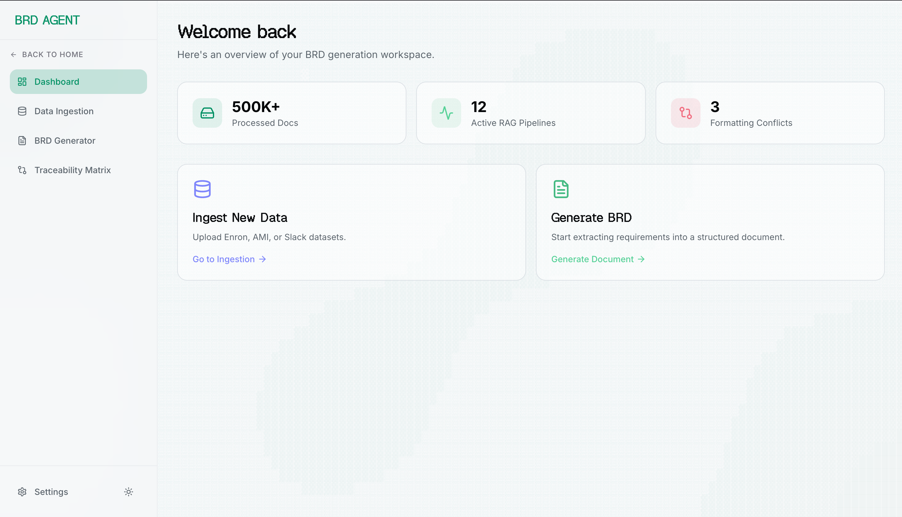
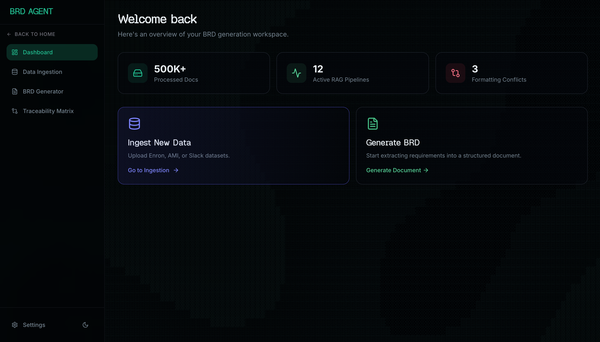
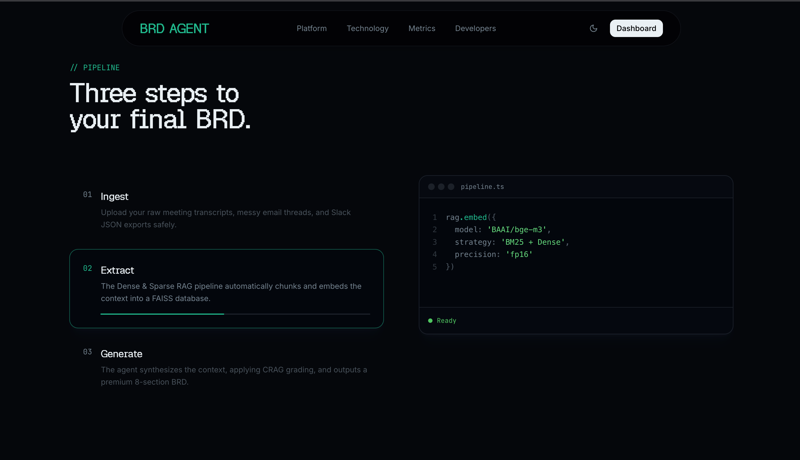
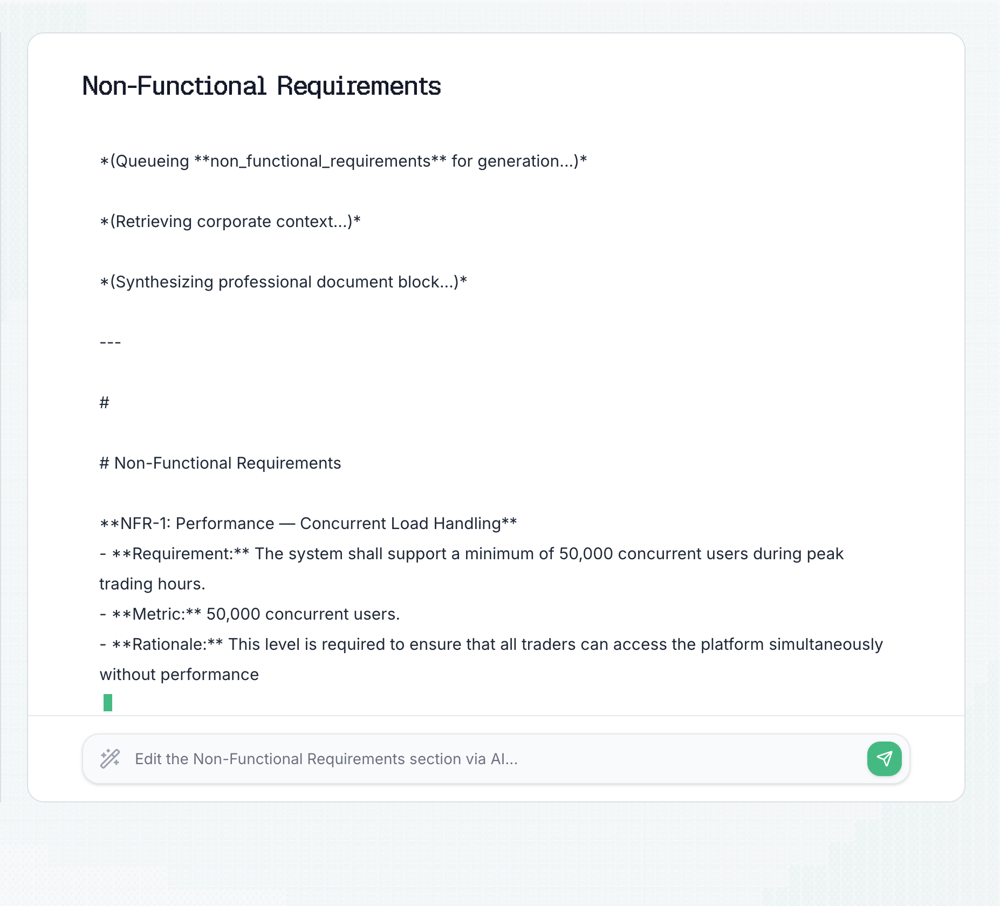
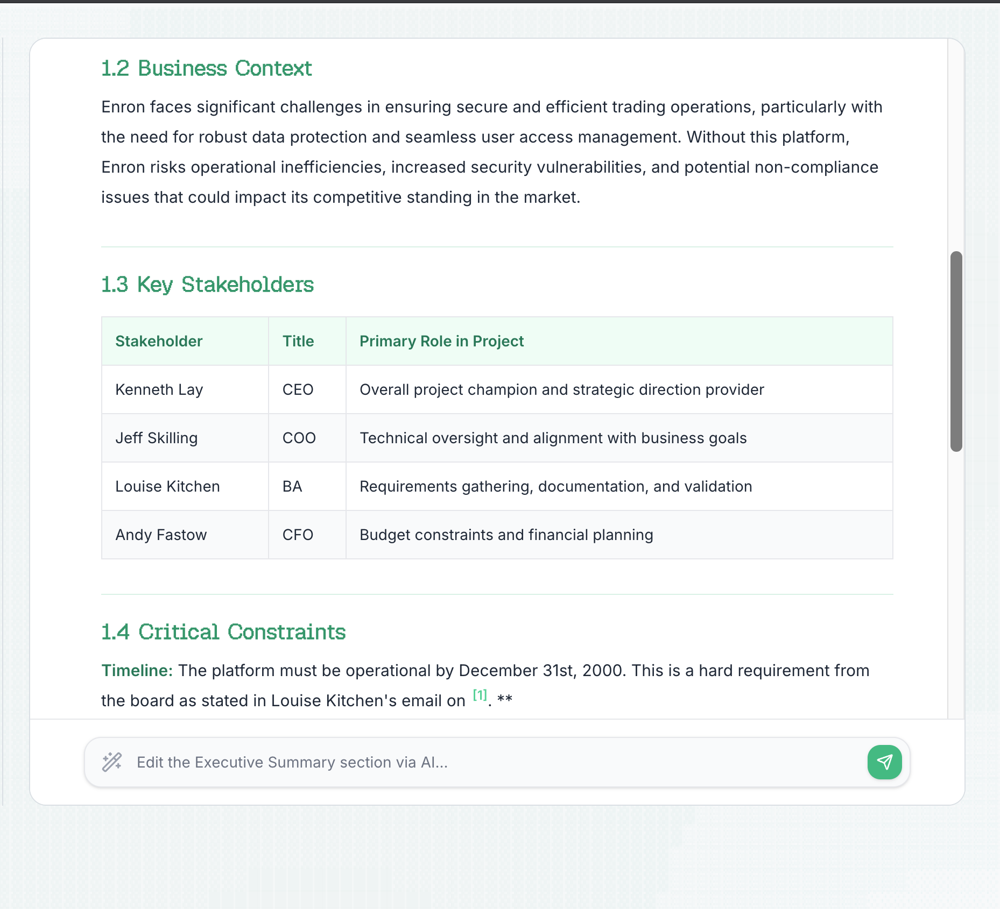
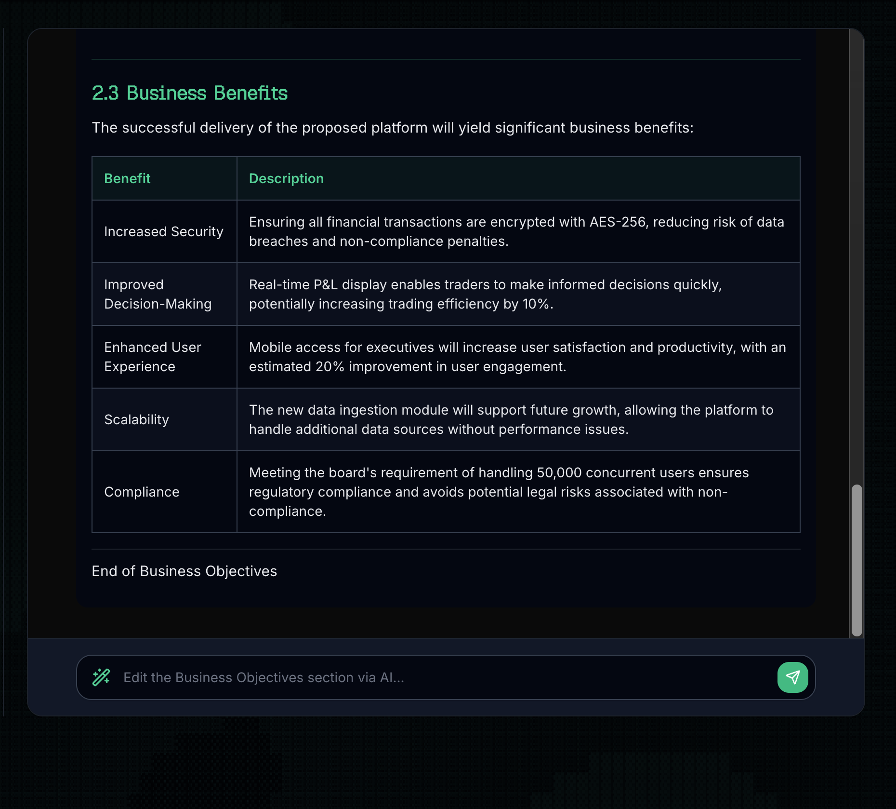
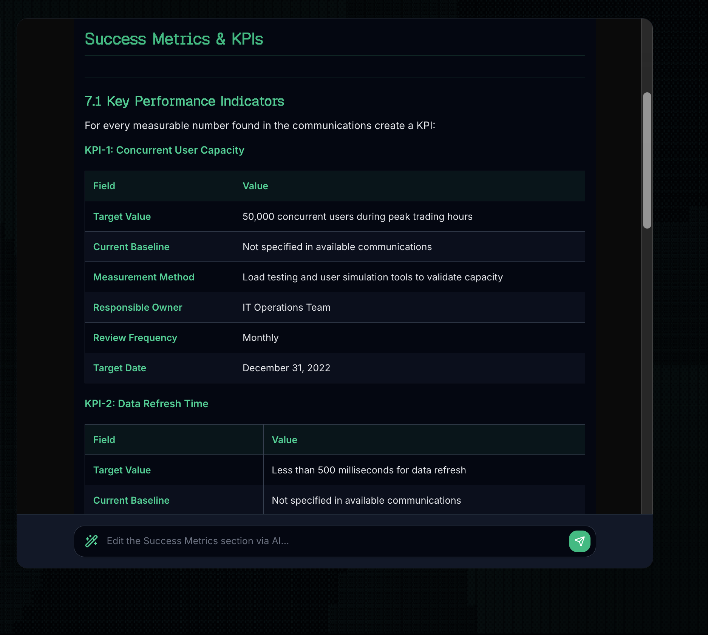
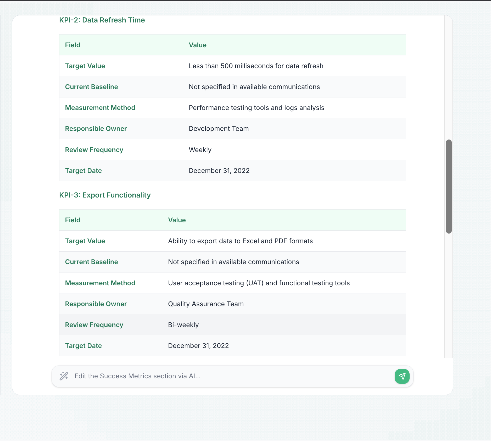
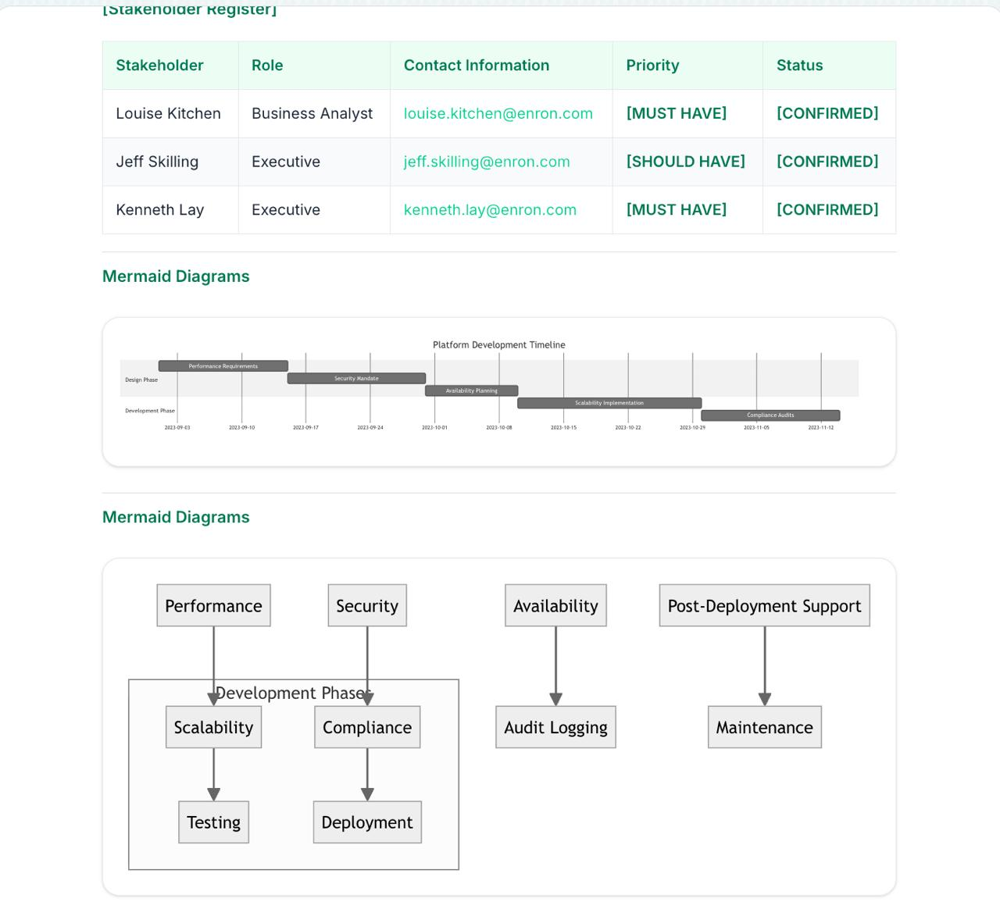
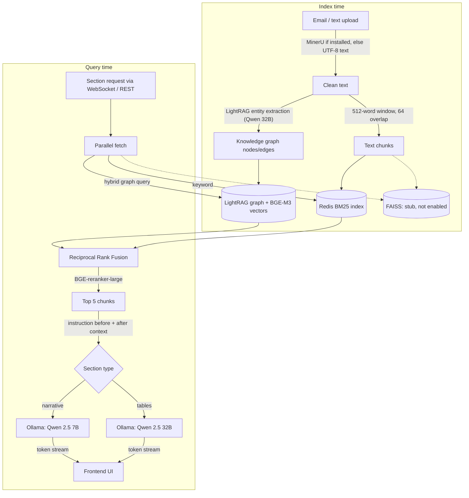

# BRD Agent: Backend

**Graph-RAG backend that drafts Business Requirements Documents from unstructured emails and notes, fully on local models.**

Built in a team at HackFest 2.0 (GDG Cloud New Delhi). This repository is the Python backend. The Next.js frontend is in a
private repository; it is shown in the screenshots below and deployed at
[brd-agent-cmka.vercel.app](https://brd-agent-cmka.vercel.app/). The backend needs a large local GPU and is offline.

## The problem

Requirements are scattered across emails, meeting notes and chat threads. Writing a Business Requirements Document (BRD)
means finding who asked for what, noticing where two stakeholders contradict each other, and attributing every
requirement to a source. Plain "retrieve and summarise" produces generic text that loses who said what.

## What it does

- **Ingests unstructured text.** Upload a file (`POST /api/ingest`) or post a raw email (`POST /ingest/email`; sender and
  subject are parsed from the headers and kept as the source name).
- **Builds a knowledge graph.** LightRAG extracts entities and relationships with `qwen2.5:32b` and stores them with
  BGE-M3 embeddings (1024-d). Chunks are also indexed for BM25 keyword search in Redis.
- **Retrieves from two sources in parallel.** LightRAG hybrid graph query + Redis BM25, merged by Reciprocal Rank Fusion
  (k = 60), reranked by the BGE-reranker-large cross-encoder; the top 5 chunks become the context.
- **Writes eight BRD sections.** Executive summary, business objectives, stakeholder analysis, functional and
  non-functional requirements, assumptions, success metrics, timeline. Each has its own prompt, token cap (1,200–2,000)
  and stop sequences at the other sections' headings.
- **Routes by section type.** Five narrative sections run on `qwen2.5:7b`; functional requirements, non-functional
  requirements and the timeline (table-heavy) run on `qwen2.5:32b`. At most three sections generate at once
  (`asyncio.Semaphore(3)`).
- **Streams to the UI.** Each section streams token by token over a WebSocket, with status lines (queued → retrieving →
  writing).
- **Repeats the instruction around the context.** Every section prompt puts the core instruction before and after the
  retrieved context, following *Lost in the Middle* (Liu et al., 2023) and *Prompt Repetition Improves Non-Reasoning
  LLMs* (Leviathan et al., 2025). The conflict and traceability prompts repeat the full instruction and context.
- **Conflicts and traceability.** `GET /conflicts` and `GET /traceability` prompt the model over retrieved context and
  return JSON (a conflict list, and a requirement → source → owner matrix). An unparseable answer returns an empty list.
- **Edits a section.** `POST /api/generate/edit` rewrites one section from a natural-language request.

## Screenshots

These show the private Next.js frontend driving this backend. Some landing-page copy names features that are not enabled
in this backend (MinerU parsing, CRAG); see [Not yet enabled](#not-yet-enabled).

### Landing page


### Dashboard

Overview of the workspace, with links to data ingestion and BRD generation.




### Architecture and components page


### Data ingestion

Uploading unstructured documents into the graph and keyword indexes.


### Generation flow

The three steps: select sources, run generation, review the document.




### Live generation

Sections stream over parallel WebSockets, with the backend's status lines (*Queueing*, *Retrieving corporate context*,
*Synthesizing*) shown before the text arrives.




### Generated document

Rendered sections: functional specifications, acceptance criteria tables, conflicts.










### Presentation diagram



## Architecture

Dashed boxes are in the code but not active (see below).



## Tech stack

| Component | Used |
|---|---|
| API | FastAPI, Uvicorn, WebSockets |
| LLM inference | Ollama (OpenAI-compatible API): `qwen2.5:32b`, `qwen2.5:7b` |
| Knowledge graph | LightRAG (`lightrag-hku`) |
| Embeddings | BAAI/BGE-M3 (FlagEmbedding) |
| Reranking | BAAI/bge-reranker-large cross-encoder |
| Keyword search | Redis with RediSearch (local Redis or Upstash, set in `.env`) |
| Hardware | Developed on a 24 GB RTX 4090 under Windows |

## Not yet enabled

These are in the code but switched off or stubbed:

| Technique | State in code |
|---|---|
| FAISS dense retrieval | `faiss_semantic_search` returns `[]` (`pipeline/retrieval.py`); FAISS is not a dependency |
| CRAG query reformulation | `MAX_RETRIES = 0`, so low-relevance retrieval never retries |
| HyDE | bypassed; the raw query is embedded directly |
| HyPE (hypothetical questions per chunk) | questions are generated and embedded at ingest, but the embeddings are not stored or searched |
| RAPTOR tree | placeholder; returns the raw chunks |
| Semantic cache (RedisVL) | answers are written, but the cache read is disabled (`if False`) |
| Whisper transcription | `whisper_engine.py` exists but nothing calls it |
| Self-consistency, two-pass (7B facts → 32B prose) | removed during the hackathon to cut latency (commit `4bf2ee1`); each section is one pass |

## Quickstart

Needs Python, a GPU that can serve `qwen2.5:32b` through Ollama, and Redis with the search module. These steps were not
re-run for this README (no GPU available); they match the code.

```bash
git clone https://github.com/auraCodesKM/brdAgentBackend.git
cd brdAgentBackend
python -m venv venv
source venv/bin/activate            # Windows: venv\Scripts\activate
pip install -r requirements.txt
cp .env.example .env                # Redis URL, HF cache, Ollama URL
python download_models.py           # BGE-M3 and reranker (also fetches Whisper and a Qwen AWQ checkpoint the Ollama setup doesn't use)

ollama pull qwen2.5:32b
ollama pull qwen2.5:7b

python -m uvicorn main:app --host 0.0.0.0 --port 8000 --workers 1
```

Then:

```bash
curl http://localhost:8000/health
python test_ingest.py               # posts 10 sample emails; the helper scripts expect port 8001
curl http://localhost:8000/conflicts
curl http://localhost:8000/traceability
```

Windows notes: [`WINDOWS_SETUP.md`](WINDOWS_SETUP.md).

### Sample data and outputs

`test_ingest.py` posts 10 short emails written for the demo, using Enron executives' names (deadline, SSO, mobile scope
and performance requirements, with deliberate contradictions). `background_ingest.py` can instead feed up to 50
keyword-matched emails from a local Enron email export (not in this repo). Outputs from runs during the hackathon are
committed: [`raw_ingested_data.md`](raw_ingested_data.md) (graph context), [`audit_brd.md`](audit_brd.md) and
[`full_audit_results.md`](full_audit_results.md) (full BRDs), and per-section checks such as
[`timeline_verification.md`](timeline_verification.md).

## Project structure

```
main.py                 FastAPI app: ingest, WebSocket/REST generation, edit, conflicts, traceability, health
pipeline/
  ingestion.py          parse → chunk → LightRAG insert → BM25 index
  rag_engine.py         LightRAG setup (Ollama, BGE-M3, reranker)
  retrieval.py          parallel fetch, RRF merge, cross-encoder rerank
  generator.py          section prompts, 7B/32B routing, streaming, edit
  conflict.py           conflict report (JSON)
  traceability.py       requirement → source matrix (JSON)
models/                 Ollama client, BGE-M3 embedder, BGE reranker
cache/                  Redis BM25 index, Redis semantic cache
test_*.py               manual scripts against a running server (not an automated suite)
app/                    early scaffold with mock routes; not used by main.py
```

## Limitations

- **No automated tests or evaluation.** The `test_*.py` files are manual scripts; output quality was checked by reading
  the generated BRDs.
- **The model can invent details.** One committed run ([`audit_brd.md`](audit_brd.md)) lists stakeholders ("John Doe",
  "Jane Smith") who are not in the ingested emails. Nothing in the pipeline checks generated claims against the sources.
- Conflicts are found by prompting over the top 5 chunks, not by graph traversal, so conflicts outside those chunks are
  missed.
- Traceability is model output; source attributions are not verified against chunk ids.
- CORS allows every origin and there is no authentication; this is a local demo server.
- `/health` returns fixed strings, and `/ingest/status` always reports completed.

Next steps: verify each generated requirement against its cited chunk, finish FAISS retrieval or remove it, and add a
small labelled set to measure conflict and traceability accuracy.
