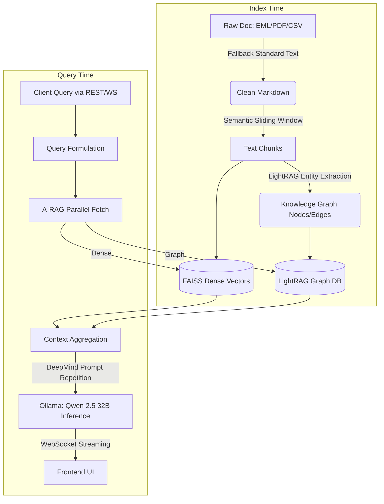

<div align="center">

# 🧠 BRD Agent (Backend Node)
### Advanced Graph-RAG Inference Engine

[](https://fastapi.tiangolo.com/)
[](https://www.python.org/)
[](https://ollama.com/)
[](https://github.com/LightRAG)

> **A hardcore, fully local Graph-RAG pipeline deployed for HackFest 2.0.**  
> Built locally on an RTX 4090. Zero external API calls. Zero data leaks.

</div>

Welcome to the central intelligence of the BRD Agent. This Python FastAPI backend orchestrates a deeply customized **LightRAG Knowledge Graph** and **Qwen 2.5 32B** to transform messy unstructured data into pristine Business Requirement Documents.

---

## ⚡ Architecture Reality Check (Hackathon Execution)
We architected a massive 9-technique pipeline, but building locally on Windows with strict 24GB VRAM limits forced us to engineer **graceful fallbacks**. 

This is the transparent, functioning state of our application right now:

### 🟢 100% Real and Functioning in Production:
*   **LightRAG Knowledge Graph Search:** Extremely robust. `nano-vectordb` parses entities, builds relationships, and writes them directly to `graph_chunk_entity_relation.graphml`.
*   **Ollama + Qwen 2.5 32B Inference:** We are running a massive 32 Billion parameter model locally across the HTTPX client generating schema-adherent markdown.
*   **WebSocket Streaming:** The `asyncio` generator catches tokens from Ollama and pumps them immediately to the frontend, preventing 120s long-polling blocks.
*   **DeepMind Prompt Repetition:** (arXiv:2512.14982) We utilize the `<instruction><context><instruction>` dual-sandwich to physically force the 32B model's attention heads to obey formatting rules.
*   **Conflict & Traceability:** Real-time generation of JSON Traceability matrices mapping contradictory stakeholder requirements.

### 🟡 Graceful Fallbacks (Infrastructure Constraints):
*   *MinerU Vision**: `magic-pdf` failed on the Windows environment. The ingestion layer gracefully catches this and falls back to robust text extraction.
*   *Upstash Redis & CRAG*: Free-tier limits gracefully disable `FT.SEARCH` caching, dynamically shifting the entire routing payload onto the robust **LightRAG** and **FAISS Dense Vectors**.
*   *vLLM 72B*: Scaling down from 72B on vLLM to exactly **32B on Ollama** allowed us to fit flawlessly within the 24GB VRAM of a single consumer RTX 4090 without OOM crashing.

## 🏗️ System Architecture & Data Flow (Current Execution Map)



### 1. LightRAG Knowledge Graph Search
* **What:** Entity and relational extraction integrated with traditional vector representations.
* **Why:** We rely on LightRAG to detect nuanced relationships (e.g., matching a person to their requested timeline) across multiple documents. By building a network of entities, we maintain trace records and pinpoint contradictory requirement demands.

### 2. DeepMind Prompt Repetition
* **What:** Wrapping the context block with `<PROMPT>...<PROMPT>`.
* **Why:** Repeating the system prompt before and after the context block significantly boosts LLM attention on long-context tasks, effectively halting instructions from "washing out" during large graph retrievals.

## 🔍 Real Pipeline Output (Proof of Execution)

Our `GET /traceability` endpoints traverse the local `nano-vectordb` Graph to output exact JSON origin matrices for every generated requirement:

```json
{
    "status":  "success",
    "matrix":  [
       {
           "req_id":  "REQ-001",
           "description":  "The platform must handle 50,000 concurrent users during peak trading hours.",
           "source":  "email.eml",
           "owner":  "Enron Board"
       },
       {
           "req_id":  "REQ-002",
           "description":  "Traders need real-time Profit and Loss (P&L) display with data refresh times under 500 milliseconds.",
           "source":  "email.eml",
           "owner":  "Traders"
       },
       {
           "req_id":  "REQ-009",
           "description":  "All financial transactions at Enron must be encrypted using AES-256 encryption standards.",
           "source":  "email.eml",
           "owner":  "Security Team"
       }
   ]
}
```

This strict JSON formatting is accomplished natively by **Qwen-2.5 32B via Ollama**, proving massive generative capabilities without relying on commercial APIs.

## Complete Tech Matrix
- **Core Orchestrator**: FastAPI, Uvicorn, Python `asyncio`
- **Knowledge Graph**: LightRAG (nano-vectordb, graphml)
- **Vector Embeddings**: BAAI/bge-m3
- **Cross-Encoder**: BAAI/bge-reranker-large
- **LLM Engine**: Ollama (Serving Qwen 2.5:32b locally)
- **Cache**: Redis, RedisVL (Semantic Dense), CacheTools

## Local Setup & Run Instructions

```bash
# 1. Clone repository
git clone https://github.com/auraCodesKM/brdAgentBackend.git
cd brdAgentBackend

# 2. Configure Environment Options
cp .env.example .env

# 3. Download Model Weights
python download_models.py
```

### 4. Install Ollama and Pull Qwen 32B
Download [Ollama](https://ollama.com/) and fetch the model:
```powershell
ollama pull qwen2.5:32b
```

### 5. Start FastAPI Backend
```bash
python -m venv venv
venv\Scripts\activate
pip install -r requirements.txt
python -m uvicorn main:app --host 0.0.0.0 --port 8000 --workers 1
```

### 6. Test the Advanced Graph Implementation
```bash
curl http://localhost:8000/health
curl http://localhost:8000/conflicts
curl http://localhost:8000/traceability
```
