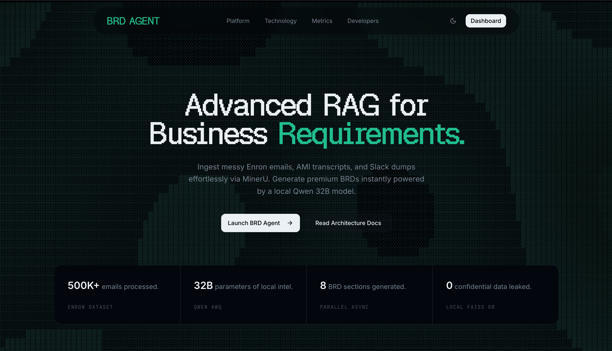
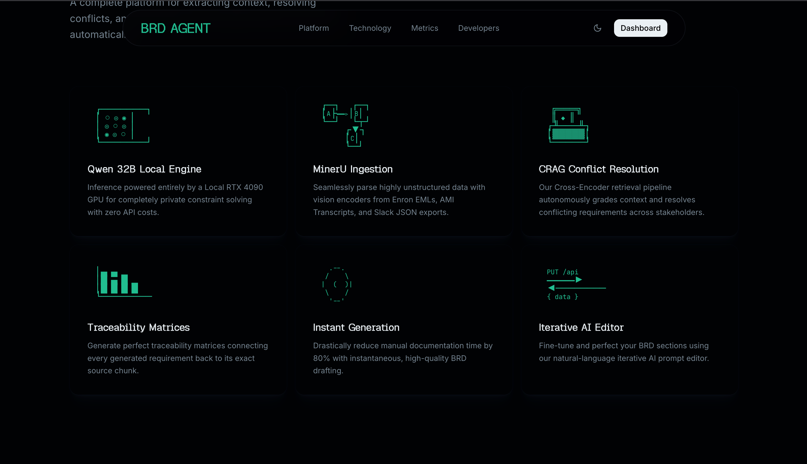
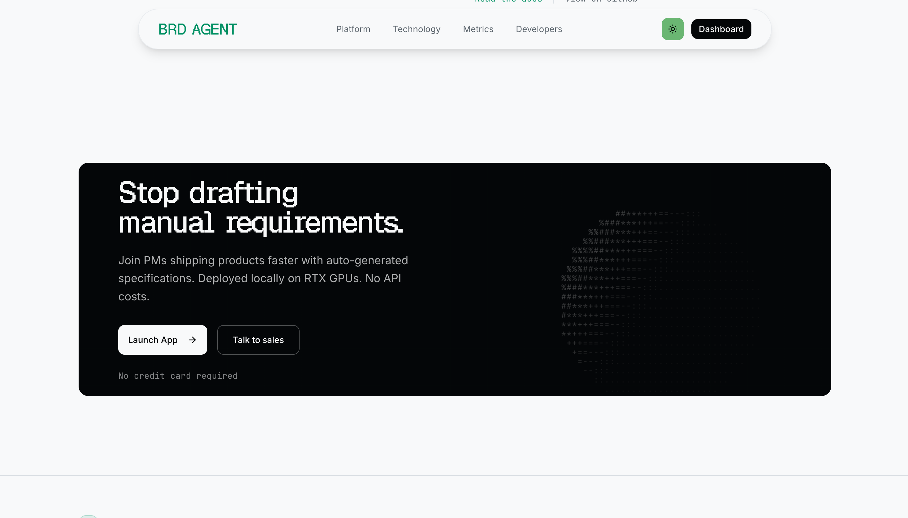
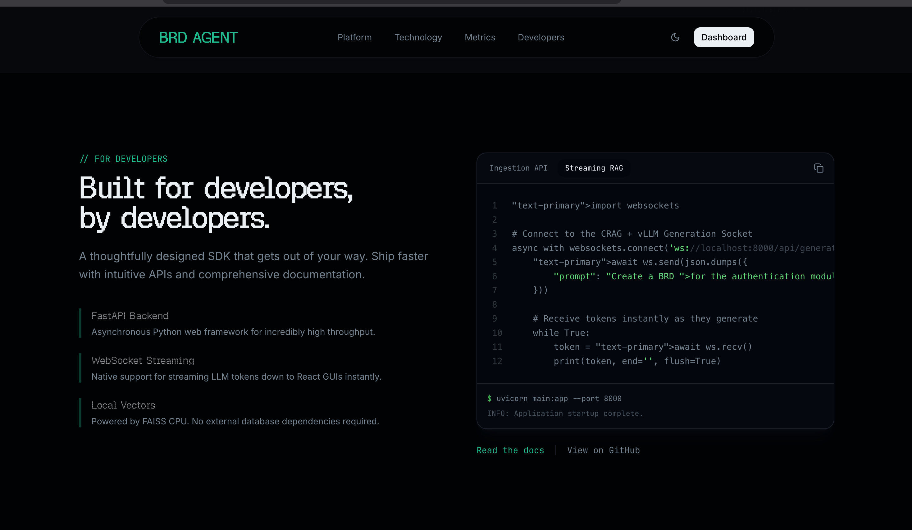
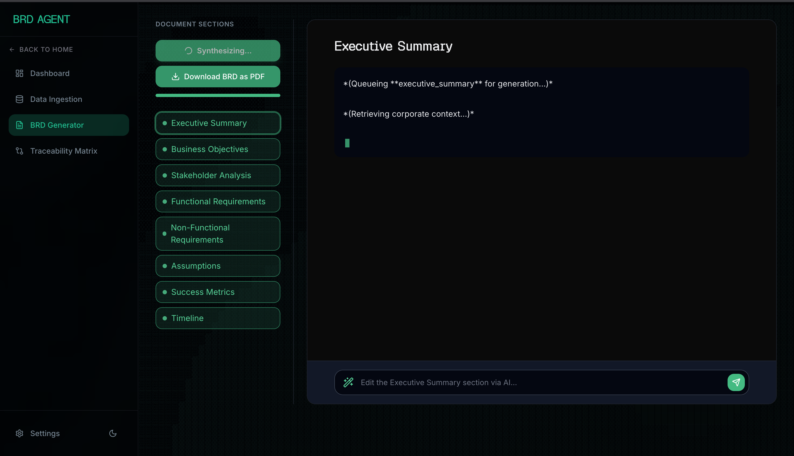
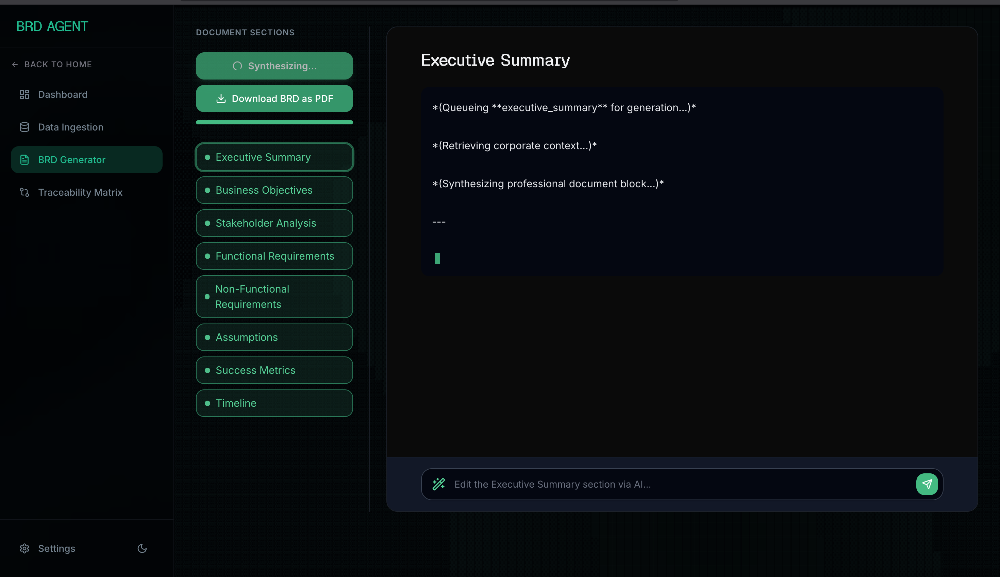
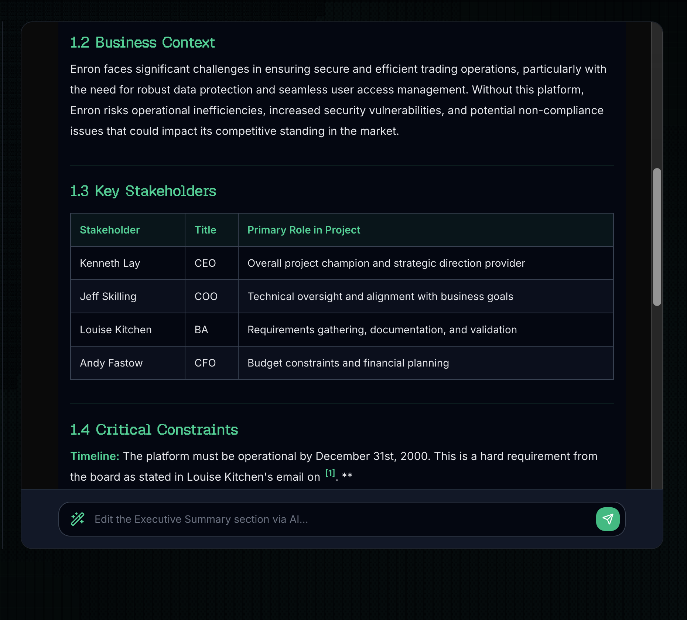
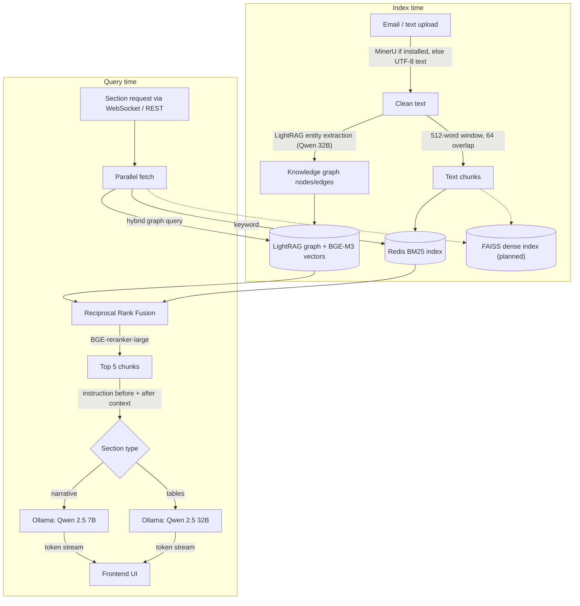

# BRD Agent: Backend

**Turns scattered emails and meeting notes into a structured, eight-section Business Requirements Document, using
graph-based retrieval and local LLMs, streamed section by section to the UI.**

Built in a team at HackFest 2.0 (GDG Cloud New Delhi). This repository is the Python backend; the Next.js frontend is
deployed at [brd-agent-cmka.vercel.app](https://brd-agent-cmka.vercel.app/). All LLM inference, embeddings and
reranking run on local models.

## The problem

Requirements are scattered across emails, meeting notes and chat threads. Writing a Business Requirements Document (BRD)
means finding who asked for what, noticing where two stakeholders contradict each other, and attributing every
requirement to a source. Plain "retrieve and summarise" loses who said what.

## What it does

- **Graph-based retrieval (Graph RAG).** Ingested text becomes a LightRAG knowledge graph of people, systems, decisions
  and their relationships, extracted by `qwen2.5:32b` and embedded with BGE-M3 (1024-d). The same chunks are indexed for
  BM25 keyword search in Redis.
- **Hybrid fusion and reranking.** Each query hits the graph and the keyword index in parallel; results are fused with
  Reciprocal Rank Fusion (k = 60) and reranked by the BGE-reranker-large cross-encoder. The top 5 become the context.
- **Eight-section BRD generation.** Executive summary, business objectives, stakeholder analysis, functional and
  non-functional requirements, assumptions, success metrics and timeline, each with its own prompt, token budget
  (1,200–2,000) and stop sequences.
- **Model routing by section.** Narrative sections run on `qwen2.5:7b` for speed; table-heavy sections (functional and
  non-functional requirements, timeline) run on `qwen2.5:32b` for structure. Up to three sections generate concurrently.
- **Live streaming.** Every section streams token by token over its own WebSocket, with progress states (queued →
  retrieving → writing).
- **Long-context prompting.** The core instruction is placed before and after the retrieved context in every prompt,
  following *Lost in the Middle* (Liu et al., 2023) and *Prompt Repetition Improves Non-Reasoning LLMs* (Leviathan et
  al., 2025).
- **Conflict and traceability analysis.** `GET /conflicts` returns stakeholder conflicts as JSON; `GET /traceability`
  returns a requirement → source → owner matrix.
- **Ingestion and editing.** Upload files (`POST /api/ingest`, MinerU parsing for PDFs when installed) or raw emails
  (`POST /ingest/email`, sender and subject kept as the source), and rewrite any section from a natural-language request
  (`POST /api/generate/edit`).

## Screenshots

The Next.js frontend driving this backend: ingestion, live section streaming and the finished document.

### Landing page




### Dashboard

Overview of the workspace, with links to data ingestion and BRD generation.


### Architecture and components page



### Data ingestion

Uploading unstructured documents into the graph and keyword indexes.


### Generation flow

The three steps: select sources, run generation, review the document.


### Live generation

Sections stream over parallel WebSockets, with the backend's status lines (*Queueing*, *Retrieving corporate context*,
*Synthesizing*) shown before the text arrives.







### Generated document

Rendered sections: functional specifications, acceptance criteria tables, conflicts.




### Presentation diagram


## Architecture

Dashed boxes are planned extensions (see the roadmap).



## Tech stack

| Component | Used |
|---|---|
| API | FastAPI, Uvicorn, WebSockets |
| LLM inference | Ollama (OpenAI-compatible API): `qwen2.5:32b`, `qwen2.5:7b` |
| Knowledge graph | LightRAG (`lightrag-hku`) |
| Embeddings | BAAI/BGE-M3 (FlagEmbedding) |
| Reranking | BAAI/bge-reranker-large cross-encoder |
| Keyword search | Redis with RediSearch (local Redis or Upstash, set in `.env`) |
| Hardware | Developed on a 24 GB RTX 4090 under Windows |

## Quickstart

Needs Python, a GPU that can serve `qwen2.5:32b` through Ollama, and Redis with the search module.

```bash
git clone https://github.com/auraCodesKM/brdAgentBackend.git
cd brdAgentBackend
python -m venv venv
source venv/bin/activate            # Windows: venv\Scripts\activate
pip install -r requirements.txt
cp .env.example .env                # Redis URL, HF cache, Ollama URL
python download_models.py           # BGE-M3, reranker and other Hugging Face checkpoints

ollama pull qwen2.5:32b
ollama pull qwen2.5:7b

python -m uvicorn main:app --host 0.0.0.0 --port 8000 --workers 1
```

Then:

```bash
curl http://localhost:8000/health
python test_ingest.py               # posts 10 sample emails (the helper scripts target port 8001)
curl http://localhost:8000/conflicts
curl http://localhost:8000/traceability
```

Windows notes: [`WINDOWS_SETUP.md`](WINDOWS_SETUP.md).

### Sample data and outputs

`test_ingest.py` posts 10 short demo emails, written with Enron executives' names, that contain deliberate
contradictions on deadline, SSO, mobile scope and performance targets. `background_ingest.py` streams up to 50
keyword-matched emails from a local Enron email export. Outputs from hackathon runs are committed:
[`raw_ingested_data.md`](raw_ingested_data.md) (graph context), [`audit_brd.md`](audit_brd.md) and
[`full_audit_results.md`](full_audit_results.md) (full BRDs), and per-section checks such as
[`timeline_verification.md`](timeline_verification.md).

## Project structure

```
main.py                 FastAPI app: ingest, WebSocket/REST generation, edit, conflicts, traceability, health
pipeline/
  ingestion.py          parse → chunk → LightRAG insert → BM25 index
  rag_engine.py         LightRAG setup (Ollama, BGE-M3, reranker)
  retrieval.py          parallel graph + keyword fetch, RRF fusion, cross-encoder rerank
  generator.py          section prompts, 7B/32B routing, streaming, edit
  conflict.py           conflict report (JSON)
  traceability.py       requirement → source matrix (JSON)
models/                 Ollama client, BGE-M3 embedder, BGE reranker
cache/                  Redis BM25 index and semantic cache
test_*.py               scripts that drive a running server (ingest, WebSocket generation, graph inspection)
```

## Design choices and roadmap

- **Local models end to end.** LLM inference, embeddings and reranking run on the machine through Ollama and
  FlagEmbedding, so documents are never sent to a hosted LLM API.
- **Two model sizes, routed by section.** The 7B model writes narrative sections fast; the 32B model handles sections
  whose tables and numbered requirements need stricter structure. A three-slot semaphore caps concurrent generation on a single GPU.
- **Graph plus keyword retrieval.** The graph captures who said what and how entities relate; BM25 catches exact terms
  (dates, figures, system names). RRF fuses them without score calibration.
- **Roadmap:** planned retrieval extensions with hooks already in the pipeline: CRAG query reformulation, HyDE, RAPTOR
  summary trees, a semantic answer cache and a dense FAISS index. Also Whisper transcription for meeting recordings and
  per-requirement checks against the cited source chunk.
