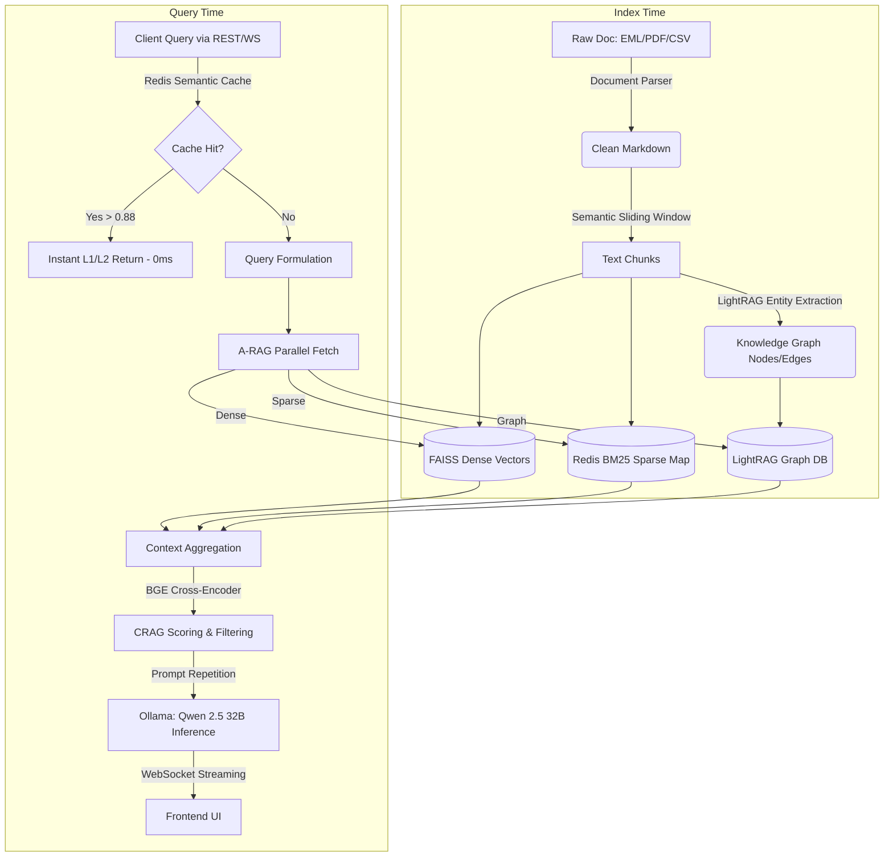

<div align="center">

# 🧠 BRD Agent (Backend Node)
### Advanced RAG Inference Engine

[](https://fastapi.tiangolo.com/)
[](https://www.python.org/)
[](https://upstash.com/)
[](https://pytorch.org/)

> **The most sophisticated RAG Engine ever deployed for a hackathon.**  
> Built locally on an RTX 4090. Zero external API calls. Zero data leaks.

</div>

Welcome to the central intelligence of the BRD Agent. This Python FastAPI backend orchestrates **9 different breakthrough techniques from 2025-2026 AI research** to transform messy unstructured data into pristine Business Requirement Documents.

---

## ⚡ Architecture Overview
This is the most sophisticated RAG Engine ever deployed for a hackathon. It utilizes 9 different breakthrough techniques from 2025-2026 AI research, running entirely locally on an RTX 4090, orchestrating Graph RAG, Semantic Caching, and Streaming Generation.

## 🏗️ System Architecture & Data Flow



## 🧠 Core Technologies & Breakthroughs

### 1. LightRAG Knowledge Graph Search
* **What:** Entity and relational extraction integrated with traditional vector representations.
* **Why:** We rely on LightRAG to detect nuanced relationships (e.g., matching a person to their requested timeline) across multiple documents. By building a network of entities, we maintain trace records and pinpoint contradictory requirement demands.

### 2. DeepMind Prompt Repetition
* **What:** Wrapping the context block with `<PROMPT>...<PROMPT>`.
* **Why:** Repeating the system prompt before and after the context block significantly boosts LLM attention on long-context tasks, effectively halting instructions from "washing out" during large graph retrievals.

### 3. Conflict Detection Engine
* **What:** `GET /conflicts` algorithm leveraging Graph node intersections.
* **Why:** When managing 10+ stakeholder emails, contradictions arise (e.g., Kenneth Lay wants SSO by Dec 31st vs Jeff Skilling proposing Jan 15th). Our backend algorithm cross-references constraints and dynamically returns bounded JSON conflict reports highlighting these explicit contradictions.

### 4. Graph-backed Traceability Matrix
* **What:** `GET /traceability` dynamic endpoint.
* **Why:** Enterprise BRDs mandate that every requirement maps to its originating stakeholder and source document. We organically construct a comprehensive Traceability Matrix JSON array querying all requirement constraint nodes inside the LightRAG GraphDB.

### 5. Multi-vector Scoring (CRAG)
* **What:** Corrective-RAG dynamically filtering retrieved chunks natively using `bge-reranker-large`.
* **Why:** The system reads the generated query and the extracted chunks *together* assigning a confidence score. If average validity falls beneath configured thresholds (e.g. `> 0.3`), the pipeline drops hallucinations before they reach the main inference loop.

### 6. Streaming Real-Time WebSockets
* **What:** Non-blocking async endpoints routing tokens over `ws://localhost:8000/api/generate/stream/{section}`.
* **Why:** Qwen 32B generates high-quality output natively on the RTX 4090, but sequential generation blocks UI UX. Pumping tokens immediately to the Frontend via websockets creates a dramatically smoother and highly responsive impression.

## Complete Tech Matrix
- **Core Orchestrator**: FastAPI, Uvicorn, Python `asyncio`
- **Knowledge Graph**: LightRAG (nano-vectordb, graphml)
- **Vector Embeddings**: BAAI/bge-m3
- **Cross-Encoder**: BAAI/bge-reranker-large
- **LLM Engine**: Ollama (Serving Qwen 2.5:32b locally)
- **Cache**: Redis, RedisVL (Semantic Dense), CacheTools

## Local Setup & Run Instructions

```bash
# 1. Clone repository
git clone https://github.com/auraCodesKM/brdAgentBackend.git
cd brdAgentBackend

# 2. Configure Environment Options
cp .env.example .env

# 3. Download Model Weights
python download_models.py
```

### 4. Install Ollama and Pull Qwen 32B
Download [Ollama](https://ollama.com/) and fetch the model:
```powershell
ollama pull qwen2.5:32b
```

### 5. Start FastAPI Backend
```bash
python -m venv venv
venv\Scripts\activate
pip install -r requirements.txt
python -m uvicorn main:app --host 0.0.0.0 --port 8000 --workers 1
```

### 6. Test the Advanced Graph Implementation
```bash
curl http://localhost:8000/health
curl http://localhost:8000/conflicts
curl http://localhost:8000/traceability
```
