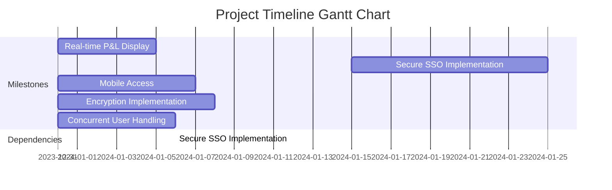
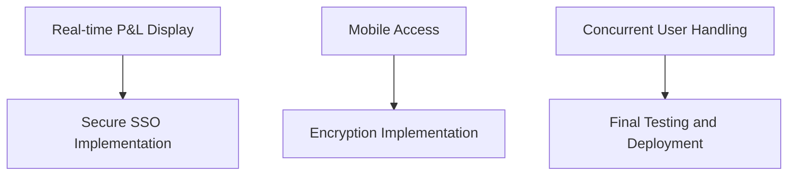

# Timeline Section Validation:

## Project Timeline

### 8.1 Phase Overview

**Phase 1**: This phase includes the development and deployment of core functionalities such as real-time P&L display, secure SSO implementation for enterprise clients, and ensuring that all financial transactions are encrypted with AES-256. The reporting module will be deferred to Phase 2 due to budget constraints. Additionally, the platform must handle up to 50,000 concurrent users during peak trading hours as mandated by the Enron Board. The target completion date for this phase is **December 31st**.

**Phase 2**: This phase focuses on adding the reporting module and resolving any outstanding issues from Phase 1. It will also include further enhancements to ensure full audit logging capabilities, which are currently constrained by the existing Postgres setup. The exact timeline for Phase 2 has not been specified in available communications.

### 8.2 Milestone Schedule

| Milestone ID | Milestone                    | Description                                                                 | Target Date   | Owner              | Dependencies                           |
|--------------|-------------------------------|-----------------------------------------------------------------------------|---------------|--------------------|----------------------------------------|
| MS-01        | Real-time P&L Display         | Implement real-time Profit and Loss display with data refresh under 500ms. | December 31st | Louise Kitchen     | -                                      |
| MS-02        | Secure SSO Implementation     | Implement secure Single Sign-On for enterprise clients.                    | January 15th  | Jeff Skilling      | MS-01                                  |
| MS-03        | Mobile Access                 | Develop iOS and Android apps for mobile access by executives.              | December 31st | Kenneth Lay, Jeff Skilling | -                                      |
| MS-04        | Encryption Implementation     | Ensure all financial transactions are encrypted with AES-256.               | December 31st | Andy Fastow         | -                                      |
| MS-05        | Concurrent User Handling      | Platform must handle up to 50,000 concurrent users during peak trading hours.| December 31st | Kenneth Lay         | -                                      |

### 8.3 Timeline Risks

**RISK-[1]: Mobile Access Inclusion in Phase 1**

- **Description:** There is a disagreement regarding the inclusion of mobile access for executives via iOS and Android apps in Phase 1.
- **Conflicting Positions:** Kenneth Lay supports including it, while Jeff Skilling opposes its inclusion due to scope concerns.
- **Impact if Unresolved:** If not decided by Friday, this could delay the overall project timeline as it significantly adds to the scope of Phase 1.
- **Resolution Required By:** Friday

### 8.4 Critical Path

The critical path for the successful launch of the proposed platform includes milestones such as MS-02 (Secure SSO Implementation) and MS-05 (Concurrent User Handling). Any delays in these milestones could result in a delay of the overall project timeline, potentially pushing back the Q4 Platform Strategy launch date. Additionally, resolving the inclusion of mobile access by Friday is crucial to avoid further scope creep that could impact Phase 1 completion.

This structured timeline ensures that all critical milestones are addressed in a timely manner, with dependencies clearly outlined to prevent delays.

